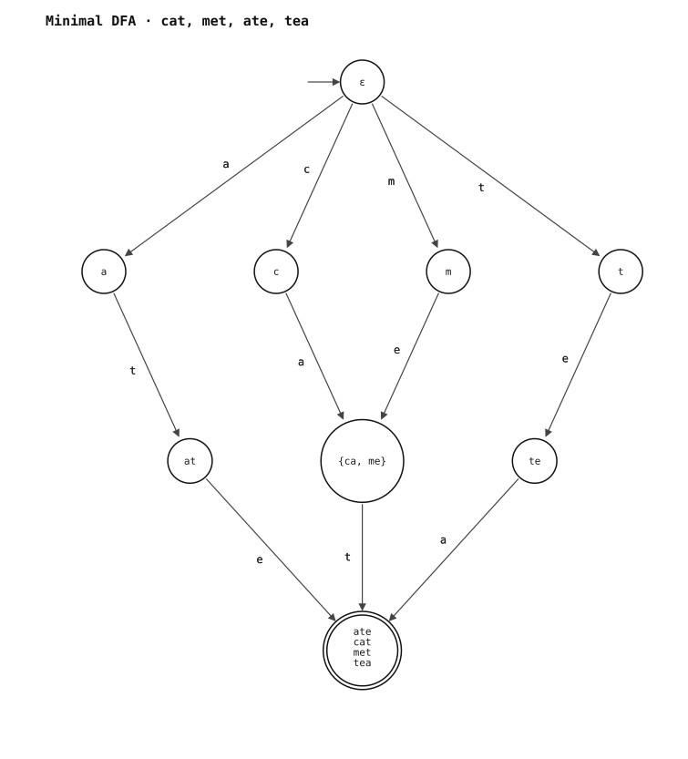
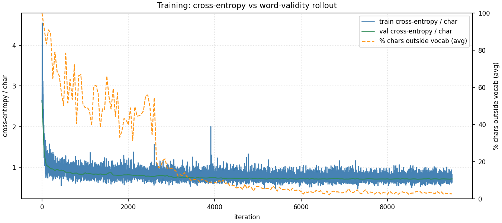
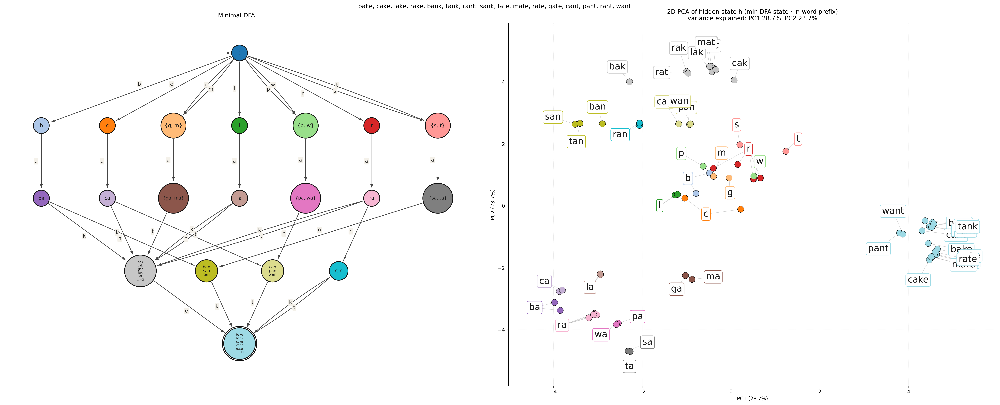
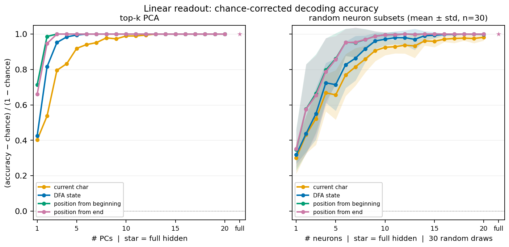
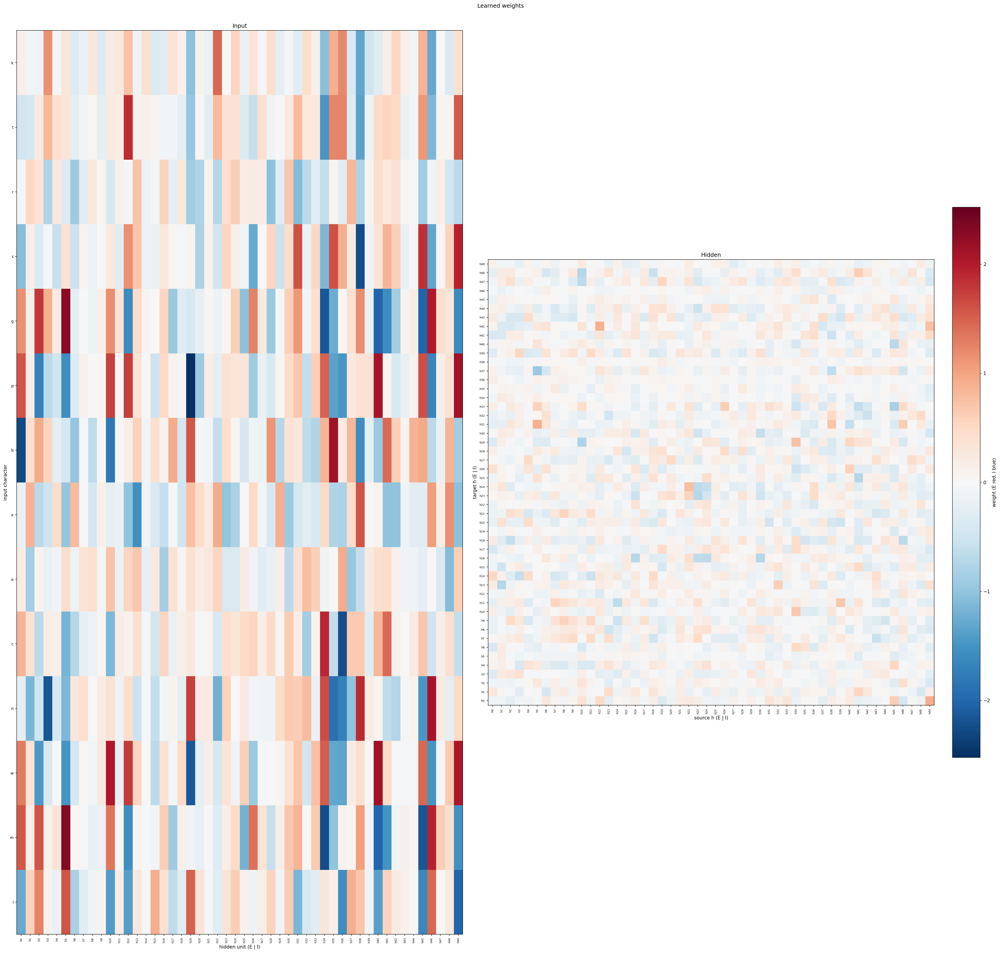
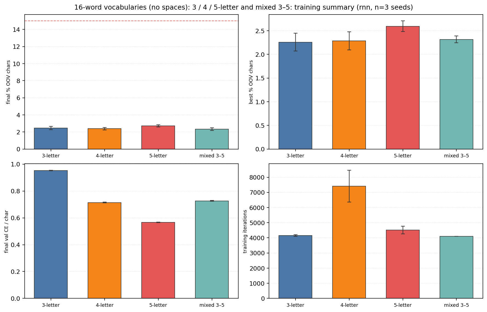
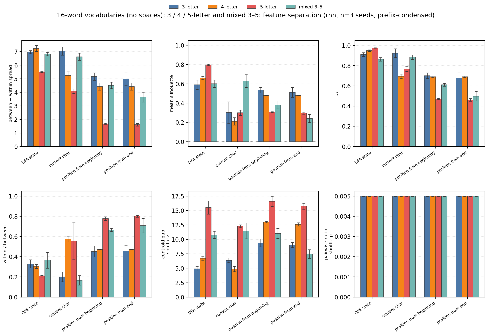

# Statistical Word Learning: RNN vs Transformer

Unified repository for **statistical learning** experiments on synthetic word vocabularies.
The same corpora and analysis pipeline are run with:

- **RNN** — minimal character-level vanilla RNN (NumPy, Karpathy-style)
- **Transformer** — small causal character transformer (PyTorch)

Outputs are organized for side-by-side comparison:

```
experiments/<regime>/
  input.txt              # shared training corpus
  shared/                # trie + DFA (same for RNN and transformer)
  rnn/
    model.npz
    plots/
  transformer/
    model.pt
    plots/
```

## Figures

These figures come from the main condition: 16 four-letter words, RNN with 50 hidden units. Captions follow `paper_figures/manifest.json`. The draft write-up is in [`paper/draft.md`](paper/draft.md).

**Vocabulary structure.** The minimized deterministic finite automaton (DFA) for the vocabulary. Each state lists the words still consistent with the prefix read since the last space.


**Learning.** Training loss, and word-error rate in sampled text.


**Hidden states embed the DFA.** PCA of RNN hidden states. Color is the DFA state; the text label is the in-word prefix.


**Word trajectories** in PCA space, from one space to the next.


**Linear decoding** of DFA state, character and position from hidden states.


**Learned weights.** Input weights W_xh and recurrent weights W_hh.


**Across word lengths.** Learning curves and feature separation.



## Quick start

```bash
pip install -r requirements.txt
python run_experiments.py --only ten_word_overlap_s --smoke
```

Remove `--smoke` for full training (15k steps, ~minutes per model).

## Run one model only

```bash
python run_experiments.py --only ten_word_overlap_s --models rnn
python run_experiments.py --only ten_word_overlap_s --models transformer
```

## Available regimes

Same word vocabularies as the original RNN repo (`task.py`):

| Folder | Words | Notes |
|--------|-------|-------|
| `ten_word_overlap` / `_s` | 10 × 3-letter | Primary demo |
| `ten_four_letter_overlap` / `_s` | 10 × 4-letter | Longer words |
| `six_word_overlap` / `_s` | 6 words | Smaller vocab |
| `twelve_word_overlap` / `_s` | 12 words | Mixed overlap |
| `sixteen_word_overlap` / `_s` | 16 words | Largest default |

`_s` variants insert spaces between words.

## Visualization

The RNN uses hidden-state geometry plots (`visualize.py --model-type rnn`).

The transformer uses **representation-specific** analysis: token embeddings, position
embeddings, block input, per-layer Q/K/V, attention weights, and block output (pre-`lm_head`)
are plotted separately — not as a single “hidden state.”

```bash
python visualize.py --exp ten_word_overlap_s --model-type rnn
python visualize.py --exp ten_word_overlap_s --model-type transformer
```

RNN-only plots (weight matrices, recurrent vector field) are skipped for the transformer.

## Repository layout

```
task.py              # Corpus generator (shared)
experiment.py        # Per-regime hyperparameters + directory layout
run_experiments.py   # Train + visualize both models
visualize.py         # Shared analysis (RNN plots + transformer adapter)
vocab_diagrams.py    # Trie + minimal DFA
readme_figures.py    # Numbered README figure names

rnn/
  min_char_rnn.py    # Vanilla RNN training
  rnn_dyn.py         # RNN dynamics helpers

transformer/
  model.py           # Minimal causal transformer
  train.py           # Character-level training
  adapter.py         # Extract Q/K/V, embeddings, attention for analysis
  viz_repr.py        # Representation-specific transformer plots
  data_char.py       # Char encoding / batching
```

## References

- Saffran, J. R., Aslin, R. N., & Newport, E. L. (1996). Statistical learning by 8-month-old infants. *Science*.
- Karpathy minimal char-RNN: https://gist.github.com/karpathy/d4dee566867f8291f086
- Source repos merged from [rnn](https://github.com/Raneem-mahajne/rnn) and [creating_transformer](https://github.com/Raneem-mahajne/creating_transformer) (`statistical_learning` branch).
